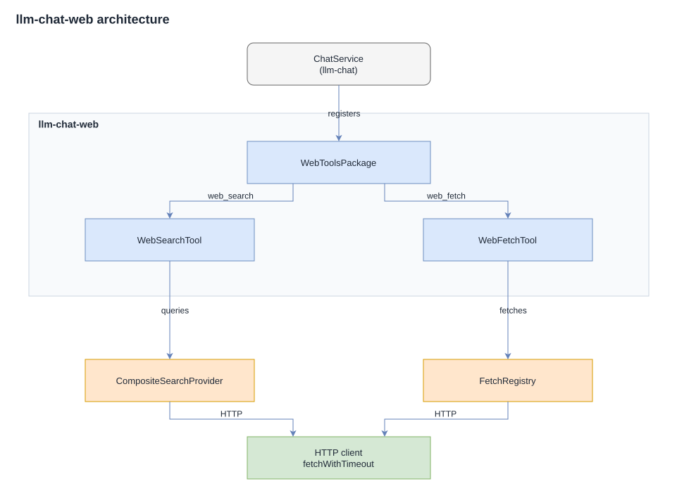

# Architecture

## Overview

`@johannes.latzel/llm-chat-web` extends the `llm-chat` framework with web search and URL fetching tools: four search providers (DuckDuckGo, Tavily, ExaAI, Firecrawl) that can be combined into a single logical provider via configurable multi-provider strategies, HTML content extraction via Mozilla Readability, configurable content-type dispatch, and size-limited fetches with concurrency control.




## Design

### Tool classes

Each tool extends `Tool` from `@johannes.latzel/llm-chat`. Both accept arrays of inputs (`queries` for search, `urls` for fetch) and return chained `PartialToolResult` results via `ResultBuilder.from(results).build()`. `p-map` manages concurrency with per-tool limits.

All errors are caught and returned as plain-string messages; tools never throw.

### WebToolsPackage

The package bundles `WebSearchTool` and `WebFetchTool` into a single `ToolPackage`. It accepts optional per-tool configurations; omitted configs default to environment-variable values.

### HTTP client

`fetchWithTimeout(url, options?)` wraps native `fetch()`:

- **Timeout**: `AbortSignal.timeout(ms)`
- **User-Agent**: constant `llm-chat-web`
- **Custom headers**: overridable via `SearchProvider.headers()`

### Search providers

The search tool delegates to one or more configured providers, each implementing the abstract `SearchProvider` class:

```typescript
abstract class SearchProvider {
    protected headers: Record<string, string>;
    abstract search(query: string, maxResults: number, maxCharsPerResult: number): Promise<WebSearchResult[]>;
}
```

| Provider | Class | Auth | Method |
|---|---|---|---|
| DuckDuckGo | `DuckDuckGoProvider` | None | HTML scraping (with anti-bot challenge detection and retry) |
| Tavily | `TavilyProvider` | API key | REST API (POST, Bearer token) |
| ExaAI | `ExaAIProvider` | API key | REST API (POST, Bearer token) |
| Firecrawl | `FirecrawlProvider` | API key | REST API (POST, Bearer token) |

Providers that require an API key extend `ApiKeySearchProvider`, which adds `Content-Type` and `Authorization` headers and provides a `postJson()` convenience method.

DuckDuckGo does not require an API key but is subject to anti-bot challenge pages. The provider detects challenge pages via structural markers (e.g. `challenge-form`, "bots use DuckDuckGo") and retries with exponential backoff (max 2 retries, base 500ms). HTTP 403 and 429 responses are also retried. Search concurrency is capped at 1 when every configured provider entry is DuckDuckGo, to reduce IP-level throttling.

Provider selection happens when the tool executes. `WebSearchTool` builds its effective provider via `resolveSearchProvider(config)`: every configured `ProviderEntry` is mapped to a concrete provider instance (missing weights default to 1), and the instances are wrapped in a `CompositeSearchProvider` that applies the configured `ProviderStrategy`. Search provider classes are not part of the public API.

#### Composite provider and strategies

`CompositeSearchProvider` combines all configured providers under one of five strategies:

- **Single**: delegates every query to the first configured provider.
- **Parallel**: queries all providers concurrently via `Promise.allSettled`; merges results, deduplicates them by URL (first occurrence wins), and truncates to `maxResults`. Partial failures are tolerated: results from successful providers are kept. Throws only when every provider fails (the first rejection reason).
- **Fallback**: tries providers sequentially in configuration order and returns the first successful result; throws the last provider's error when all fail.
- **WeightedRandom**: picks one provider per query using cumulative weight distribution; entries without a `weight` count as 1.
- **RoundRobin**: cycles through the providers across consecutive queries; the rotation index lives on the composite instance.

Zero-config setups resolve a single keyless `duckduckgo` entry, so the composite always contains at least one provider.

### WebSearchTool specifics

The tool builds its provider from the configuration once per execution (`resolveSearchProvider`) and delegates each query independently. Timeouts and headers use the shared HTTP client.

### WebFetchTool specifics

#### Content extraction

`extractText(html, url?)` processes HTML through a pipeline:

1. **Parse** with `JSDOM`
2. **Strip** `<script>`, `<style>`, `<noscript>`, `<iframe>` from the DOM
3. **Gate** with `isProbablyReaderable()`: if false, skip Readability
4. **Extract** with `Readability.parse()`: if result is < ~100 chars, fall through
5. **Fallback** probe content selectors: `article`, `main`, `[role="main"]`, `.post-content`, `.entry-content`, `.content`. If none match, use `document.body.textContent`.

Returns `{ title, textContent, content, excerpt, byline, siteName }`.

#### Truncation

When content exceeds `max_chars`, the truncation algorithm walks down boundary types:

1. **Paragraph break** (`\n\n`): cuts at the last paragraph break within the budget window
2. **Sentence break** (`.`, `!`, `?`): cuts at the last sentence-ending punctuation
3. **Word break** (last space): guarantees no mid-word cuts
4. **Hard cut**: last resort, only when no boundary is found

The `[truncated]` marker is included in the character budget. Its prefix depends on the boundary used: `\n\n[truncated]` after a paragraph break, ` [truncated]` after a sentence break or hard cut, and ` ...[truncated]` after a word break.

When truncation happened, a character-count hint is appended after the marker, e.g. `[HTML text truncated to 100 of 500 characters]`. The label names the content type (`PDF text`, `HTML text`, `JSON`, or `text`). `truncateWithHint()` produces the truncated text plus the hint, and `appendHint()` appends it to the result.

#### Content-size guard

Before downloading, the tool sends a `HEAD` request to check `Content-Length`. If it exceeds the configured limit, the fetch is rejected immediately.

#### Content-type handler dispatch

When a response is received, `WebFetchTool` looks up the `Content-Type` header in a `FetchRegistry`: a list of `ContentHandler` instances checked in registration order. The first handler whose `match()` returns `true` processes the body via `handle()`. The body is passed as a `Uint8Array` together with a `HandleOptions` object (`{ maxChars, maxPages? }`); text handlers decode it as UTF-8, while binary handlers (such as PDF) read the bytes directly.

`WebFetchTool` creates its own `FetchRegistry` if none is provided and calls `init()` in its constructor. Built-in defaults are populated only if no custom handlers were registered beforehand, so a registry with custom handlers takes priority over the built-in set (see [usage](usage.md#content-type-handling) for the handler table and examples).

#### Header rules

`WebFetchConfiguration.headerRules` holds host-controlled `HeaderRule` entries (`{ pattern, headers }`). `resolveHeaderRules(url, rules)` matches each pattern against the full URL with `@johannes.latzel/pattern-specific`, merges the matches from least to most specific (more specific overrides), and the result is passed to both the content-length `HEAD` probe and the `GET` request. Headers are never supplied by the model.

## Dependencies

- `@johannes.latzel/llm-chat`: framework providing `Tool`, `ToolParameters`, `ResultStatus`, `ResultBuilder`, etc.
- `@johannes.latzel/pattern-specific`: glob matching and most-specific-wins ordering
- `@mozilla/readability`: article content extraction
- `jsdom`: server-side DOM for Readability integration
- `unpdf`: PDF text extraction (bundled Mozilla PDF.js)
- `p-map`: concurrency-limited parallel execution
